# The Grey Strand

### A website built as a house.

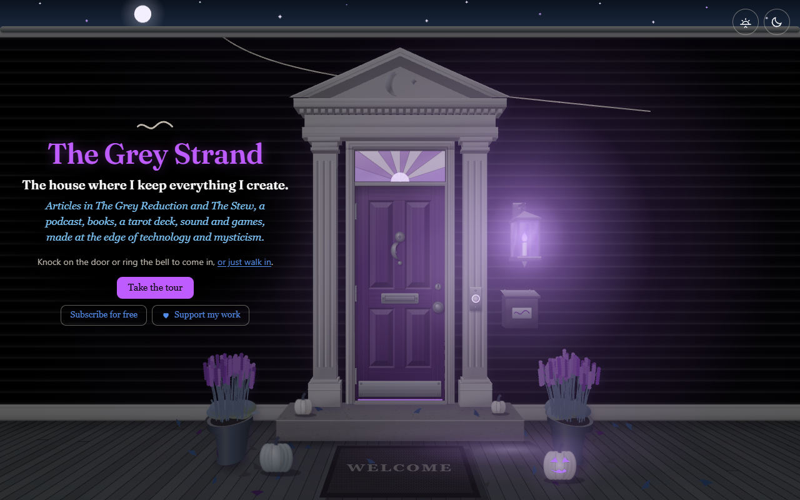

**[thegreystrand.com](https://thegreystrand.com)** is where Greygray keeps everything he creates: articles, a podcast, books, a tarot deck, paintings, sound, software and games. It is not laid out as a menu of pages. It is a house. You come in by the front door, and each room holds a different kind of work.

A grey strand runs through every page of it. It follows you as you go, it rings when you cross it, and when you pull it, it sings on a slow, steady beat, starting on a note set by where you took hold and climbing as you draw it out. Let go and it springs back into place with a chord.

## The rooms

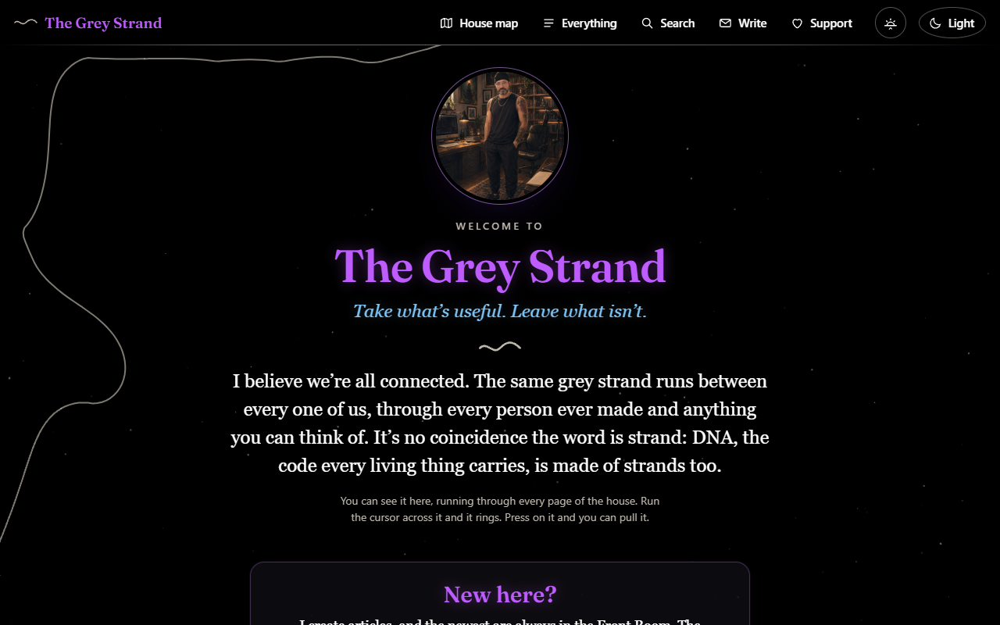

* **The Entry.** Announcements, the whole house on one map, and a letterbox for writing to him.
* **The Kitchen.** The Grey Reduction, his series of articles.
* **The Dining Room.** The Stew, his other series.
* **The Breakfast Nook.** The podcast, playing right on the page.
* **The Study.** The books he has published.
* **The Office.** The books still being made, and a receipt for every pass of research behind the work: the date, what it was for, a summary and every source, so the work can be checked.
* **The Library.** Old spiritual texts, free to read, each with a note on what to expect and a link straight to the text. Each one says who it is by, whose translation it is, and whether it is in the public domain or a modern translation shared free.
* **The Bathroom.** The Mirror Tarot: every card, and a free three-card reading. A mirror, not a forecast.
* **The Hallway.** His paintings, hung along the wall.
* **The Basement.** Frequencies to sit with, free to play or to keep.
* **The Garage.** The software he has made.
* **The Back Yard.** Games and worlds, some of them playable right there.

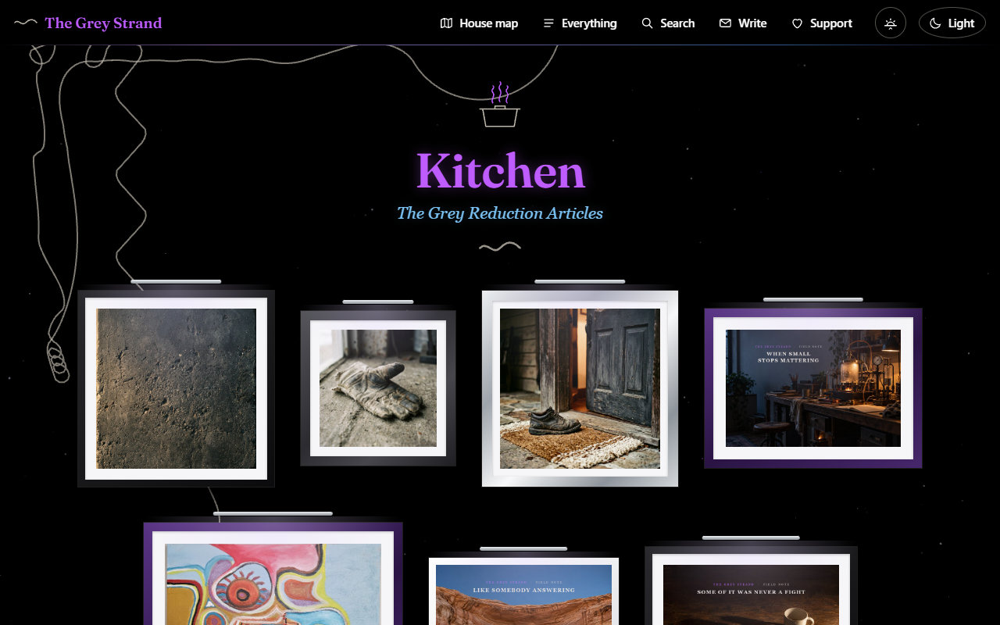

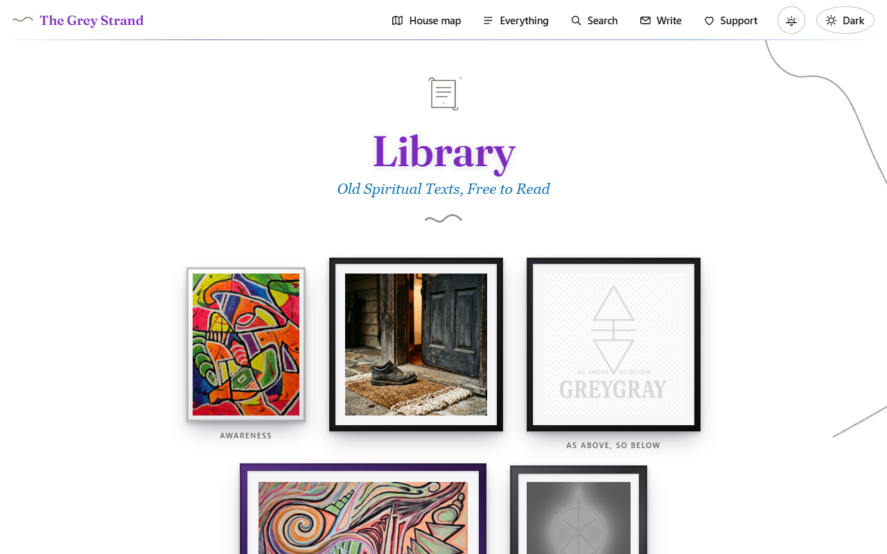

## More rooms

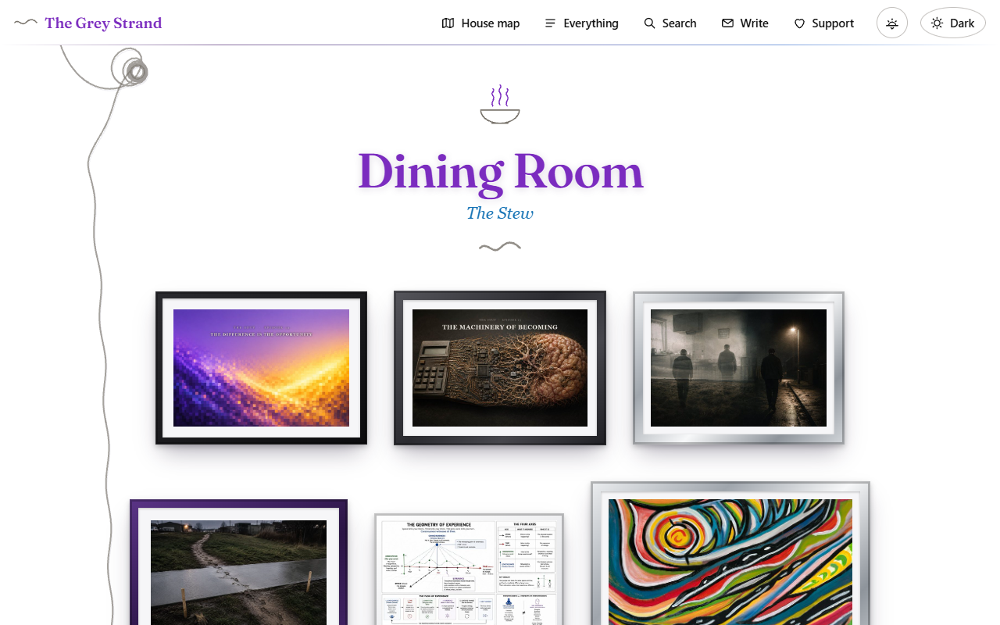

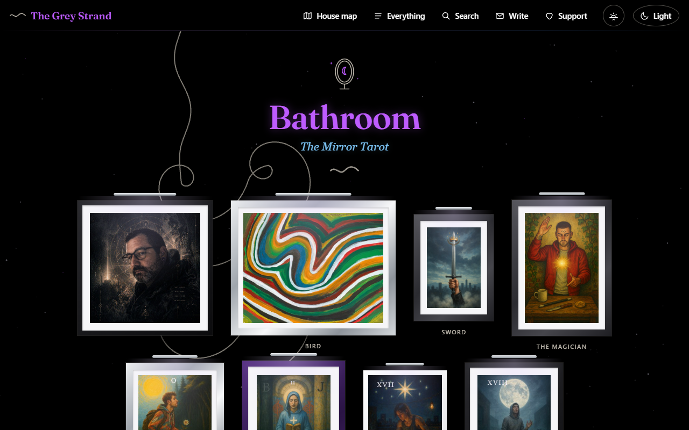

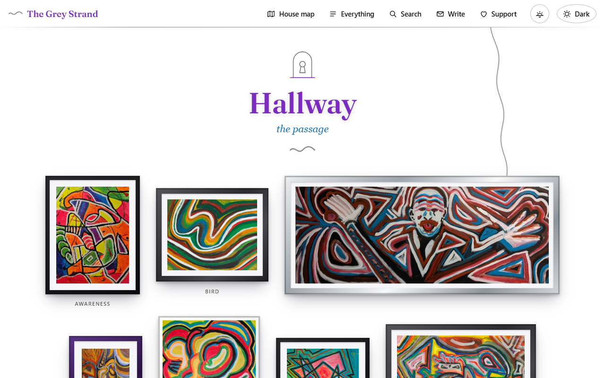

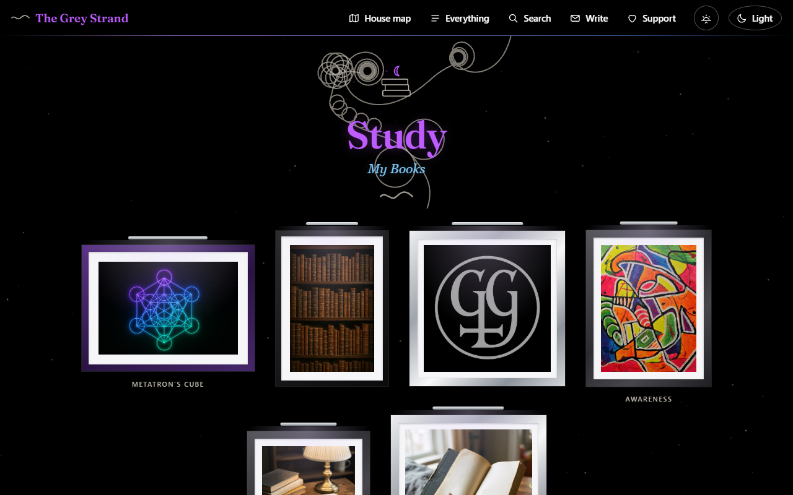

## A house that keeps time

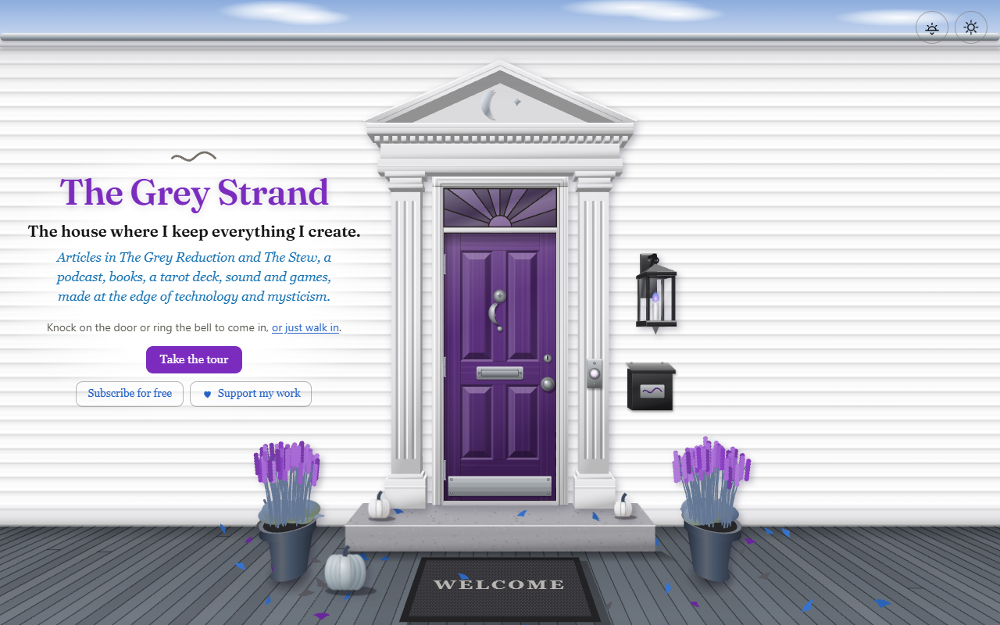

* **Day and night follow your sky.** The house turns light at your sunrise and dark at your sunset, wherever you are, and the switch is always yours.
* **The seasons change on the front step.**
* **A first visit can take the tour:** the house in the order of the strand, a line for every room.
* **It works on a phone as well as a desk.**

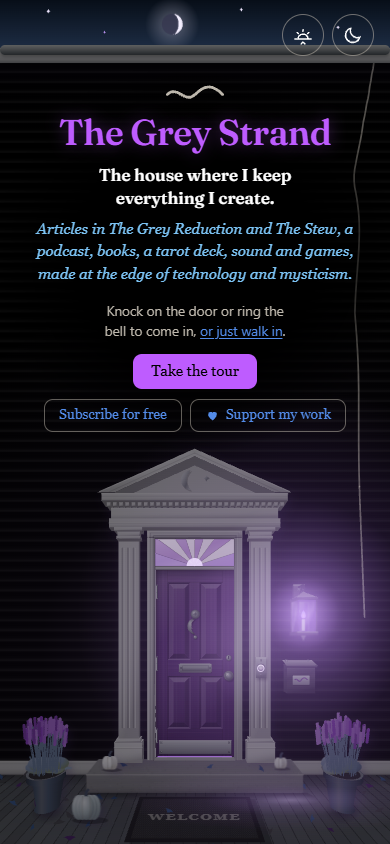

## Made the way he makes everything

AI is openly part of how this house was built and how its research is done. He directs it, judges the result in use, and decides what stays. Every piece of research that goes into the work is on file in the Office, with its sources, so nothing has to be taken on trust.

No ads. No affiliate links.

## Not every door is on the map

There is a door in this house with no name on it. Nobody says what is inside.

That one is yours to find.

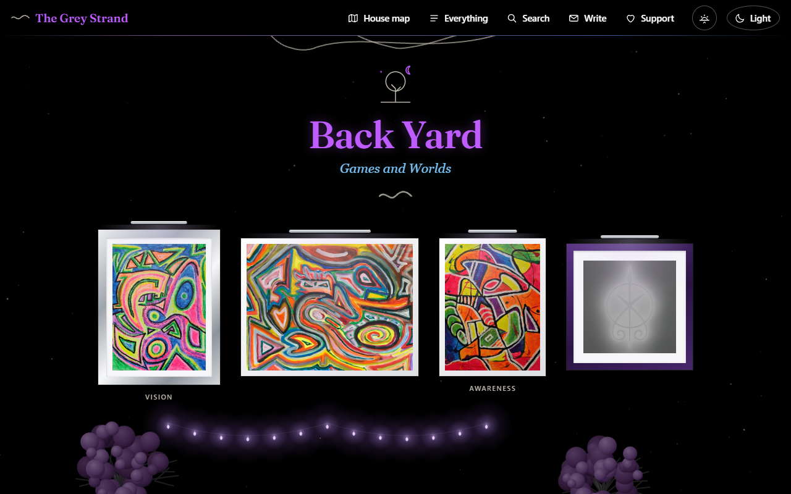

---

The house's working source stays private. This page shows what the house is, and it is updated with the house.

**[Come in.](https://thegreystrand.com)**
